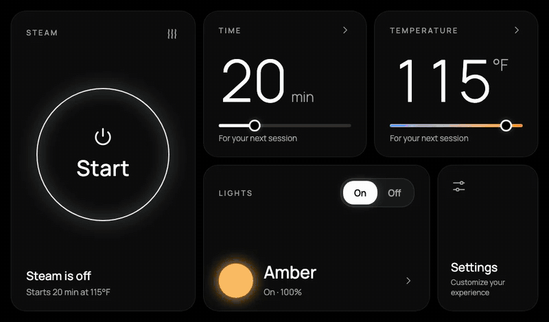
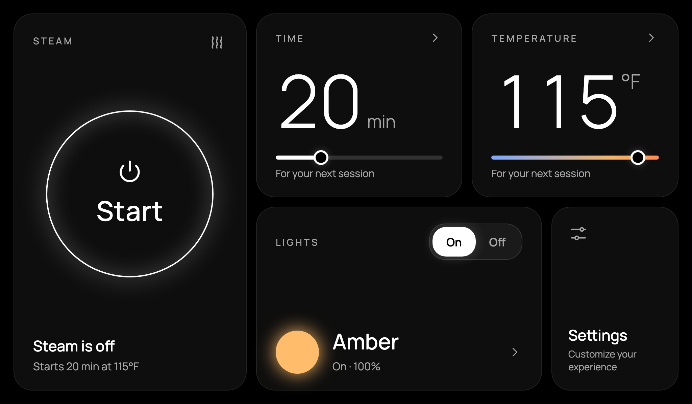
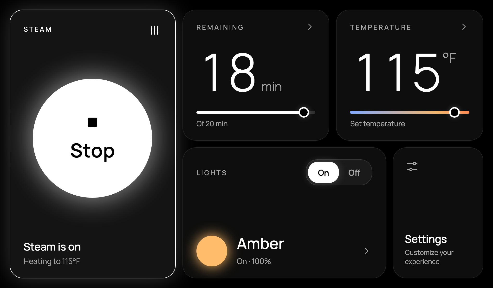
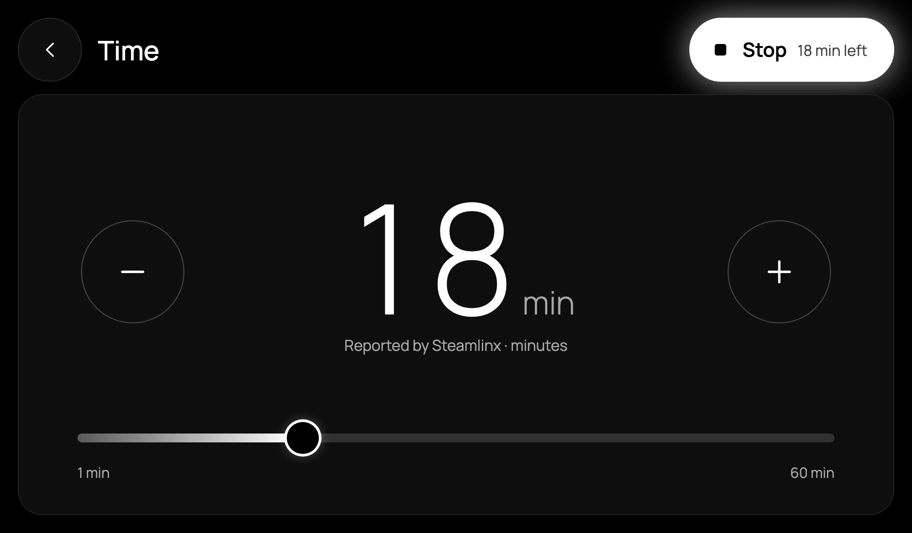
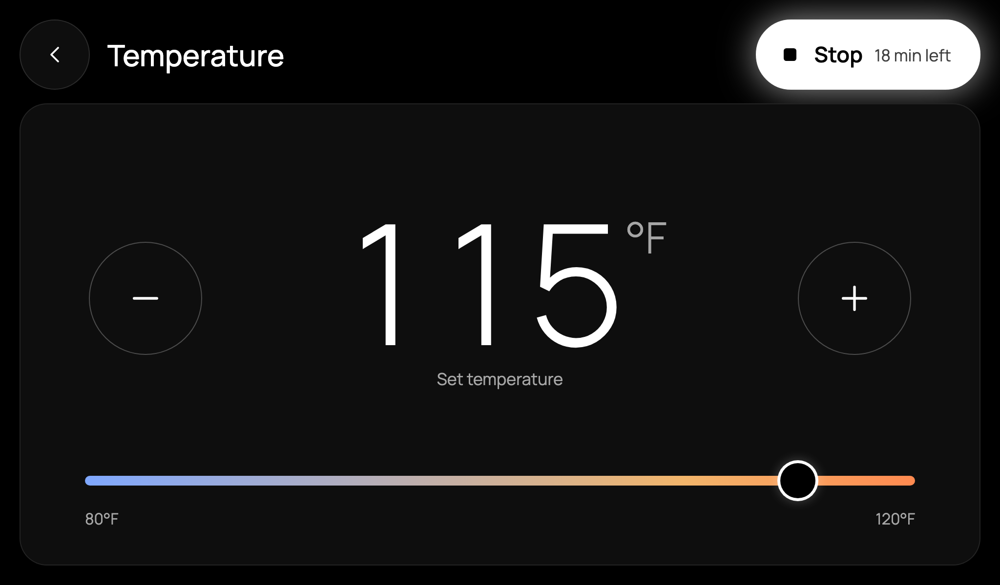
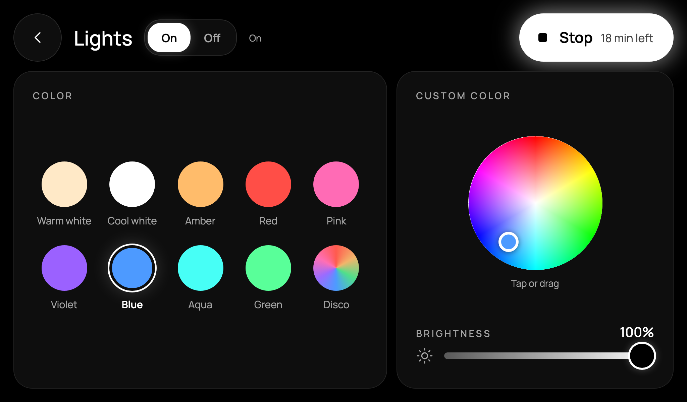
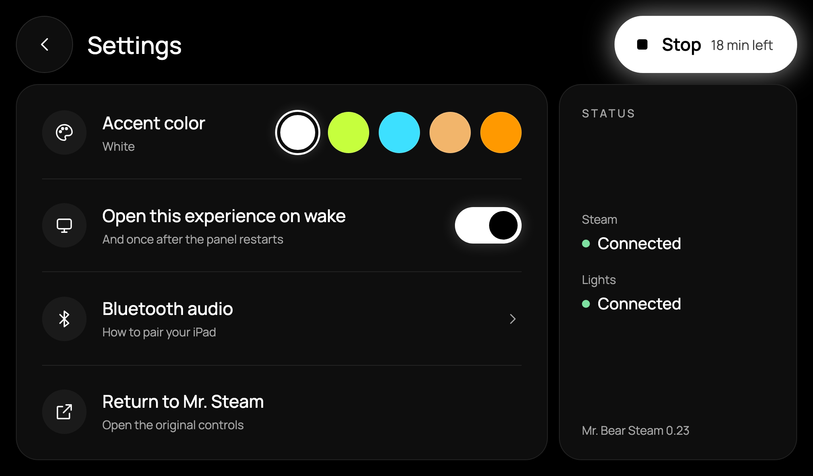
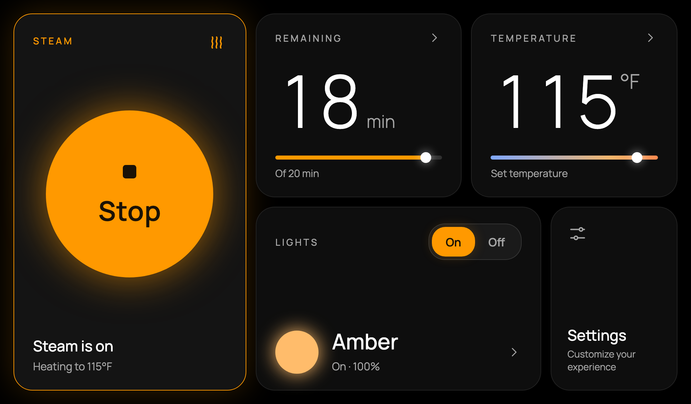
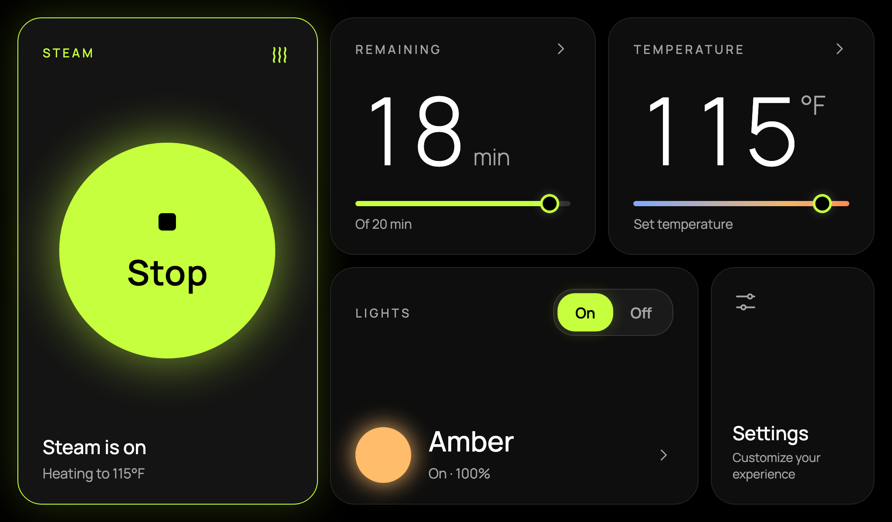
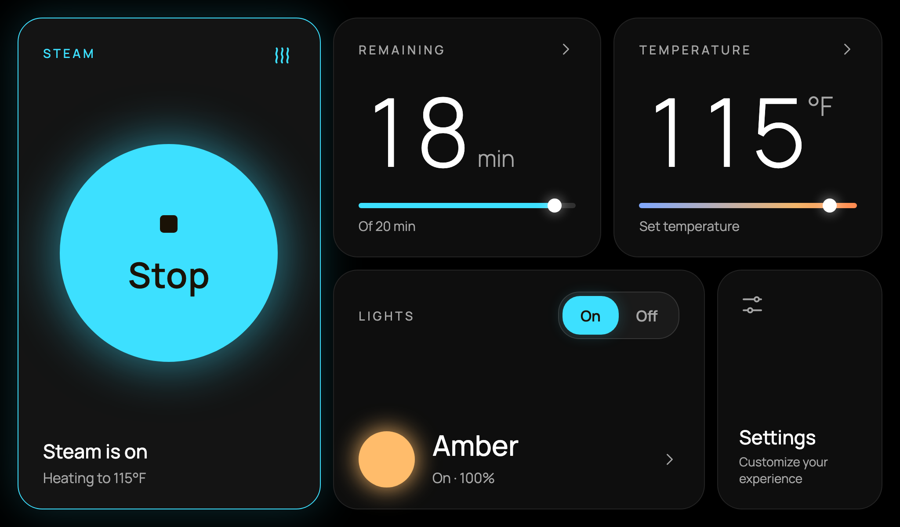

# Mr. Bear Steam

A faster, cleaner dashboard for Mr. Steam iSteamX steam-shower wall panels. It runs on the panel itself (Android 10) and sits on top of the original Mr. Steam app, which stays installed and keeps doing its job underneath.

*A 40-second tour ([full-quality MP4](docs/media/mr-bear-steam-tour.mp4)). Rendered from the app's own page at the panel's 1024×600 size, with simulated equipment.*

**Not affiliated with, endorsed by or supported by Mr. Steam.** "Mr. Steam", "iSteamX" and "Steamlinx" are used only to say what this works with. This controls a heater and a steam generator. Read [SAFETY.md](SAFETY.md) before you build or install anything.

## What it does

- **Steam:** one large Start/Stop button, time (5 to 60 minutes) and temperature (80 to 120 °F) with sliders and +/-. Stop always works, even while other controls are locked.
- **Lights:** On/Off, ten color presets, a custom color wheel, brightness and Disco. The panel remembers the last color you chose.
- **Opens by itself:** when the screen wakes, and once about 45 seconds after the panel restarts. A 1.5 second guard ignores the tap that woke the screen (except Stop).
- **Settings:** five accent colors, "Open this experience on wake", Bluetooth audio pairing steps, and one tap back to the original Mr. Steam app.
- **Sleeps when idle:** with the steam off, the screen turns off after 5 minutes without a touch, or 3 minutes after a steam session ends. Never while steam is running.
- **Black theme** designed for a 1024×600 wall panel.

| | | |
|---|---|---|
|  |  |  |
|  |  |  |
|  |  |  |

All screenshots are in [docs/screenshots](docs/screenshots). To regenerate them and the video after a UI change, see [tools/demo/tour.cjs](tools/demo/tour.cjs).

Steam is controlled locally over the Steamlinx bridge on your home network (UDP). Lights go through the same Mr. Steam cloud account the original app uses. See [docs/HOW-IT-WORKS.md](docs/HOW-IT-WORKS.md).

## Status

Version 0.25 runs daily on one iSteamX panel (Android 10, PX30). It has not been tried on any other panel, firmware or Mr. Steam model. If you try it, please open an issue with what you found, even if it did not work.

## Getting started

You need a Mac or Linux machine on the same network as the panel, a JDK, the Android SDK build tools, Python 3 and Node.js. [docs/SETUP.md](docs/SETUP.md) walks through:

1. `household.json`: your bridge, light and network values (never committed).
2. A certificate for the one-time sign-in handoff and diagnostics.
3. Your own signing key.
4. `python3 controls/verify.py` (about 800 automated checks, no hardware needed), then `python3 controls/build.py`.
5. Installing on the panel and turning on Bear's accessibility service.

## Repository

| Path | What |
|---|---|
| `controls/` | The Android app (Java + one WebView page), build and test scripts, the Mac setup server |
| `controls/tests/` | Unit, loopback, page and emulator tests. All of them run on fake equipment |
| `remote-support/` | Optional owner-started screen sharing and tap relay, used to test on a panel with no ADB |
| `agent-tools/timeline/` | Read-only CLI for the diagnostic timeline the panel streams to your Mac |
| `docs/` | Setup, how it works, screenshots and the tour video |
| `tools/demo/` | Records the tour video and screenshots from the real page with simulated equipment |

## Contributing

Forks and pull requests are welcome. [ROADMAP.md](ROADMAP.md) lists ideas that are ready to pick up, including Settings shortcuts and in-app updates. [CONTRIBUTING.md](CONTRIBUTING.md) has the ground rules: tests stay green, no identifiers in commits, and nothing sends a steam command that the user did not tap.

## Credits

- Built by [@abearknowshow](https://github.com/abearknowshow) with AI coding agents. Astra built the early versions (0.1 to roughly 0.15): the protocol, the overlay and the remote-support tooling. Claude Opus 5.5 in Claude Code took it from 0.16 to 0.25: speed, reliability, the new interface, start-on-wake and idle sleep.
- The Steamlinx wire format was learned from [gazoodle/geckolib](https://github.com/gazoodle/geckolib) (GPL-3.0), and the cloud lighting from [pedantique/mrsteam-homeassistant](https://github.com/pedantique/mrsteam-homeassistant) (MIT).
- Third-party licenses are in [NOTICE](NOTICE) and `controls/assets/notices/`.

## License

GPL-3.0. See [LICENSE](LICENSE).
